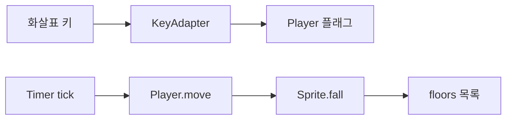
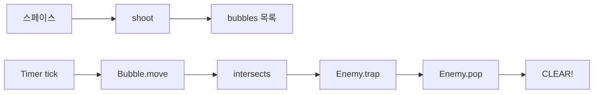
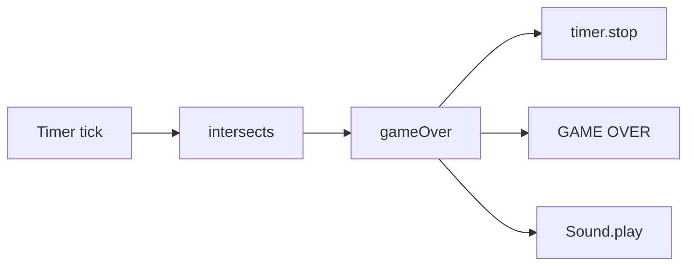

# 시나리오별 구조도

## 걷고 뛰기

만든 장: player-move, wall-stop, floor-gravity, player-jump, sprite-refactor
맡는 파일
- bubble/src/bubble/game/BubbleFrame.java
- bubble/src/bubble/game/Player.java
- bubble/src/bubble/game/Sprite.java
- bubble/src/bubble/game/Direction.java

## 물방울로 가두고 터트리기

만든 장: bubble-shoot, bubble-pop, enemy, enemy-trap, enemy-pop
맡는 파일
- bubble/src/bubble/game/BubbleFrame.java
- bubble/src/bubble/game/Bubble.java
- bubble/src/bubble/game/Enemy.java

## 게임오버

만든 장: bgm, game-over
맡는 파일
- bubble/src/bubble/game/BubbleFrame.java
- bubble/src/bubble/game/Sound.java
- bubble/src/bubble/game/Player.java
